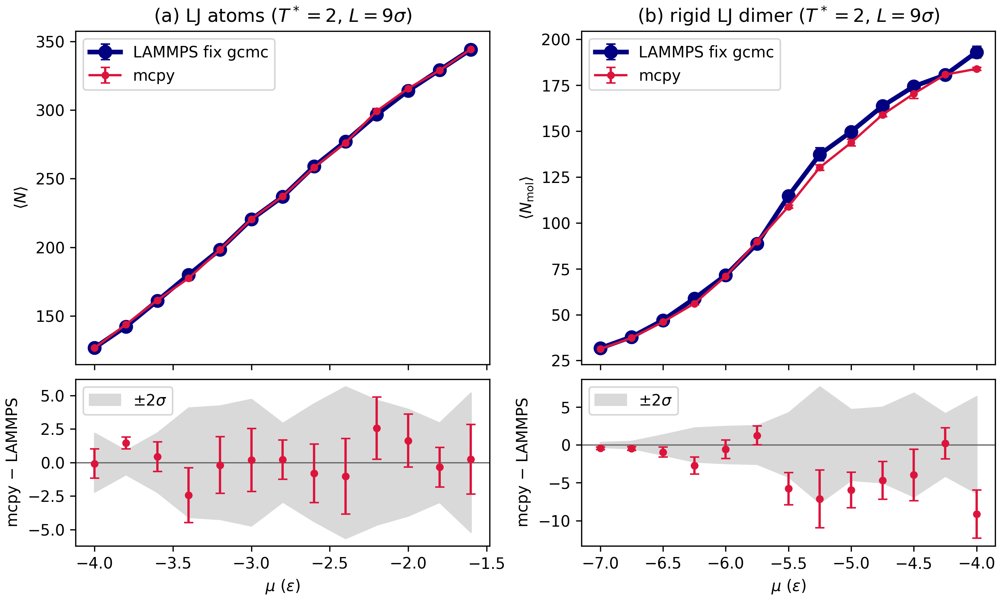

# Benchmarks: mcpy GCMC vs LAMMPS `fix gcmc`

mcpy's grand-canonical sampler, for both atomic and rigid-molecule moves, has been cross-validated against LAMMPS.
Three rerunnable campaigns live in this directory; the tables below are their verdicts.

## 1. Lennard-Jones parity (`lammps_gcmc_parity.py`)

Setup: LJ units, T* = 2.0, cubic box L = 9 sigma, truncated-and-shifted lj/cut 3.0 matched between codes to <= 1e-8 by a two-body probe.
Both codes get the same trial budget and move mix (200k trials per run), with four independently seeded runs per chemical potential and 40% burn-in.
A stage passes on a chi-square test of the mcpy - LAMMPS differences over all its points (p > 0.01 for both <N> and <PE>).

Stage 0, ideal gas vs the analytic grand-canonical result (<N> = 98.66):

| code | <N> | deviation |
|---|---|---|
| mcpy | 98.97 ± 0.94 | 0.34 sigma |
| LAMMPS | 98.56 ± 0.75 | 0.13 sigma |

Stage 1, atomic LJ isotherm (insert + delete + translate); chi2 = 14.8 over 13 points for <N> (p = 0.32) and 19.5 for <PE> (p = 0.11), **pass**:

| mu | <N> mcpy | <N> LAMMPS | d (sigma) |
|---|---|---|---|
| -4 | 126.72 ± 0.23 | 126.80 ± 1.07 | 0.08 |
| -3.8 | 143.77 ± 0.37 | 142.29 ± 0.25 | 3.31 |
| -3.6 | 161.42 ± 1.01 | 160.98 ± 0.44 | 0.40 |
| -3.4 | 177.49 ± 1.24 | 179.94 ± 1.62 | 1.20 |
| -3.2 | 198.18 ± 1.84 | 198.36 ± 1.05 | 0.09 |
| -3 | 220.52 ± 1.73 | 220.33 ± 1.60 | 0.08 |
| -2.8 | 237.13 ± 1.15 | 236.91 ± 0.91 | 0.15 |
| -2.6 | 258.13 ± 0.88 | 258.93 ± 2.01 | 0.37 |
| -2.4 | 276.00 ± 0.66 | 277.03 ± 2.75 | 0.36 |
| -2.2 | 299.25 ± 1.71 | 296.67 ± 1.58 | 1.11 |
| -2 | 315.68 ± 1.51 | 314.04 ± 1.29 | 0.82 |
| -1.8 | 328.71 ± 0.87 | 329.05 ± 1.19 | 0.23 |
| -1.6 | 344.29 ± 1.99 | 344.05 ± 1.66 | 0.09 |

Stage 2, rigid LJ dimer exchanged as whole molecules (mcpy `MoleculeInsertionMove`/`MoleculeDeletionMove` vs LAMMPS `fix gcmc mol`, exchange-only); chi2 = 53.1 over 13 points for <N_mol>, **fail**:

| mu | <N_mol> mcpy | <N_mol> LAMMPS | d (sigma) |
|---|---|---|---|
| -7 | 31.29 ± 0.14 | 31.75 ± 0.06 | 2.90 |
| -6.75 | 37.36 ± 0.17 | 37.87 ± 0.16 | 2.14 |
| -6.5 | 46.01 ± 0.56 | 46.96 ± 0.35 | 1.45 |
| -6.25 | 56.05 ± 0.68 | 58.79 ± 0.89 | 2.45 |
| -6 | 70.88 ± 1.03 | 71.48 ± 0.65 | 0.50 |
| -5.75 | 89.79 ± 0.81 | 88.55 ± 0.98 | 0.98 |
| -5.5 | 108.84 ± 0.79 | 114.62 ± 1.95 | 2.75 |
| -5.25 | 130.15 ± 1.47 | 137.27 ± 3.53 | 1.86 |
| -5 | 143.69 ± 1.77 | 149.65 ± 1.52 | 2.56 |
| -4.75 | 158.90 ± 1.17 | 163.59 ± 2.19 | 1.89 |
| -4.5 | 170.36 ± 2.61 | 174.34 ± 2.20 | 1.17 |
| -4.25 | 180.74 ± 0.79 | 180.54 ± 1.90 | 0.10 |
| -4 | 183.86 ± 0.71 | 193.00 ± 3.10 | 2.87 |

The stage-2 gap is mostly a LAMMPS sampling bias, not an mcpy error.
LAMMPS `fix gcmc` (stable 29Aug2024, `attempt_molecule_insertion`) orients an inserted molecule by a random axis and a rotation angle drawn uniformly in [0, 2 pi), which is not a uniform rotation: 25% of inserted dimer axes fall within 26 degrees of the template axis, against 10% for uniform rotations.
Exchange-only runs never rotate a molecule after insertion, so the bias persists.
mcpy draws uniform rotations (normalized four-Gaussian quaternion).
Rerunning mcpy with the LAMMPS rotation scheme and the same seeds moves it most of the way to LAMMPS at the dense points (mu = -5.0: 143.7 to 148.9 vs LAMMPS 149.6; mu = -4.0: 183.9 to 189.3 vs 193.0).
A smaller residual at the dilute end is within the run-to-run scatter of LAMMPS itself (mu = -7.0: mcpy 31.29 ± 0.14 against 31.21 ± 0.11 from eight longer LAMMPS runs).
The ideal rigid-dimer gas, where orientation does not matter, matches the analytic result to 0.2% in mcpy.

Rerun: `python benchmark/lammps_gcmc_parity.py --stage all` (needs a LAMMPS binary with the MC and MOLECULE packages, e.g. conda-forge `lammps`; pass it with `--lmp`).
With `--stage all` a failed stage aborts the later ones; run `--stage 1` and `--stage 2` separately to get both.

## 2. MACE parity (`mace_gcmc_parity.py`)

Same protocol with the MACE-MPA-0 potential (metal units, T = 400 K), against a LAMMPS build with `pair_style mace` (ACEsuit fork) using the identical exported model.

| check | result |
|---|---|
| Single-point energies (Ag2O probe; Ag slab + O2 adsorbed and beyond cutoff) | agree to 1e-5 eV (1e-9 in float64) |
| Ideal rigid-O2 gas, physical de Broglie wavelength (mass 32) vs analytic | both codes <= 1 sigma |
| LAMMPS region + `full_energy` machinery vs analytic (zero potential) | pass |
| Interacting O2/Ag(111) GCMC | disagrees, isolated to a LAMMPS-side defect |

The interacting disagreement was dissected to a defect in the LAMMPS-MACE fork's `fix gcmc` trial-insertion path, not in mcpy:
LAMMPS's own deletion acceptance matches textbook theory exactly (20.3% measured vs predicted) while its insertions are ~5x suppressed and insensitive to mu, consistent with the inserted molecule's intramolecular edge missing from the trial-energy graph, and the same code path segfaults when started from an empty or near-empty box.
mcpy evaluates every trial with a freshly built graph by construction, so this failure mode cannot occur.

Net result: **mcpy reproduces LAMMPS everywhere LAMMPS's own machinery is sound**, and mcpy's MACE GCMC is validated by composition (sampler proven on LJ, potential proven pointwise against `pair_style mace`).

Rerun: `python benchmark/mace_gcmc_parity.py --lmp <patched lmp> --model <model-lammps.pt> --python-model <mace model>` (the ACEsuit LAMMPS build recipe and full forensic notes are kept with the internal material).

## 3. Paper Figure 1: LJ isotherms (`lammps_lj_isotherms.py`)

Two single-species Lennard-Jones systems, run with both codes on the same potential, initial state, move mix and trial budget, four seeds per point:
a purely repulsive LJ fluid (LJ units, T* = 1) and argon in metal units (T = 87.79 K) across the gas-liquid condensation.
The dense argon liquid relaxes slowly under GCMC in both codes, so liquid points start from a liquid equilibrated by one long LAMMPS run; unequal run lengths otherwise show up as a spurious few-percent gap.

| system | chi2 of mcpy - LAMMPS | points | max deviation |
|---|---|---|---|
| repulsive LJ | 10.2 | 11 | 2.3 sigma |
| argon | 21.1 | 14 | 2.9 sigma |

Rerun: `python benchmark/lammps_lj_isotherms.py` (about 4 h on 24 cores; writes `benchmark/lj_isotherms/`), or `--plot` to redraw from the CSV.

## Internal material

Profiling, memory-scaling studies, raw run outputs, and detailed campaign notes are deliberately kept out of the public tree (`benchmark/internal/`, git-ignored); ask the maintainers if you need them.
