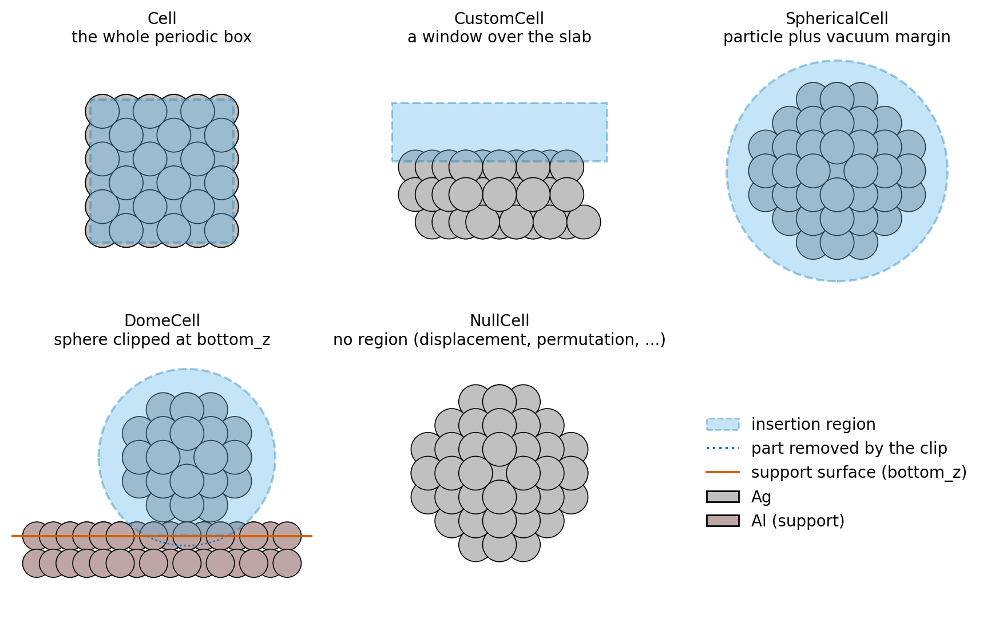

Cells
=====

Cell objects in `mcpy` define **where** Monte Carlo moves act and **how much free volume** is
available for insertions. They are the geometric counterpart of the move set: every cell
provides random points for insertion, classifies atoms as "inside" the active region, and
returns the accessible volume :math:`V_{\mathrm{free}}` used by the GCMC acceptance rules
(see :ref:`free-volume`).

Five cell types are exported from `mcpy.cell`: four region geometries, and `NullCell` for
moves that sample no region at all (displacement, shake, permutation and MD moves).

.. code-block:: python

   from mcpy.cell import Cell, CustomCell, SphericalCell, DomeCell, NullCell

   The five cell types (side views, ``docs/make_figures.py``). The shaded
   region is where insertion points are drawn. The ``DomeCell`` sphere is
   clipped at the support surface (``bottom_z``), and ``NullCell`` has no
   region.

Choosing exclusion radii (`species_radii`)
------------------------------------------

Every non-trivial cell takes a `species_radii` argument: an element-wise dictionary of
exclusion radii. These radii control how the free-volume Monte Carlo estimator labels each
sampled point as occupied or free, and therefore directly determine the
:math:`V_{\mathrm{free}}` that appears in the GCMC acceptance terms.
Insertion moves apply the same rule: a point within an atom's radius (periodic images
included) is redrawn, so insertions are uniform over :math:`V_{\mathrm{free}}`.
Deletion moves use :math:`V_{\mathrm{free}}` of the state after the deletion.
See :doc:`gcmc_acceptance_convention` for why both rules are needed.

The thesis underlying this library calls this quantity :math:`r_{\mathrm{relax}}`.
It is the most frequent nearest adsorbate-host distance after a local relaxation of random insertions.
It is the centre of the tallest bin (the mode) of the histogram of these distances.
Measure it with the *same* calculator and relaxation settings as in production.
Using values that are too small inflates insertion attempts into atomic cores; using values that are too large collapses :math:`V_{\mathrm{free}}` and freezes the chemistry.
See :doc:`species_radii` for a complete, reproducible workflow (including a ready-to-use script for O on Ag) and the recommended conventions for mapping pair distances onto element-wise radii.

Sampling resolution (`mc_sample_points`)
----------------------------------------

`mc_sample_points` sets the maximum number of random points used in the free-volume estimate.
The first estimate draws all of them.
Each later estimate draws only enough points for about 0.5% relative noise on
:math:`V_{\mathrm{free}}`.
For a free fraction :math:`f` of the previous estimate, that is
:math:`N = (1-f)/(f \cdot 0.005^2)` points, between 5000 and `mc_sample_points`.
A mostly free region thus needs far fewer points than the cap, and a nearly full one uses the cap.
In practice, :math:`10^5` points is a good cap for nanoparticle- and slab-sized systems.
The ensemble recomputes the estimate after every accepted move, and each deletion trial computes
one for its post-deletion state.

`Cell` -- full periodic simulation box
--------------------------------------

`Cell` uses the full ASE simulation cell (`atoms.cell`) as the active MC region. Random
points are sampled uniformly in fractional coordinates and mapped to Cartesian space.

Use this when the active region is simply the entire periodic box.
Without `species_radii` nothing is excluded and the volume is the exact box volume.
With `species_radii` the volume is the free volume, as for the other cells.

.. code-block:: python

   from mcpy.cell import Cell

   cell = Cell(atoms, species_radii={"O": 0.5, "Ag": 2.14})
   cell.calculate_volume(atoms)
   V = cell.get_volume()

`CustomCell` -- rectangular sub-slab
------------------------------------

`CustomCell` carves out a sub-volume that spans the full :math:`x` and :math:`y` extent of
the simulation box but has a finite thickness along :math:`z`. This is the standard
construction for surface slabs, where insertions should be limited to the topmost layers
and a slice of vacuum above them.

Key parameters:

- `custom_height` -- thickness of the active region along :math:`z`,
- `bottom_z` -- :math:`z`-coordinate of its lower face,
- `species_radii` -- per-element exclusion radii,
- `mc_sample_points` -- free-volume sampling resolution.

The sub-slab is the region ``bottom_z <= z < bottom_z + custom_height``.
The `a` and `b` box vectors must have no :math:`z` component, or the constructor raises ``ValueError``.
A tilted `c` vector is allowed: the cell scales it, so the sub-slab keeps the shear of the box.

.. code-block:: python

   from mcpy.cell import CustomCell

   custom_cell = CustomCell(
       atoms,
       custom_height=5.5,
       bottom_z=5.0,
       species_radii={"O": 0.5, "Ag": 2.14},
       mc_sample_points=100_000,
   )
   custom_cell.calculate_volume(atoms)

`SphericalCell` -- nanoparticle-centred region
----------------------------------------------

`SphericalCell` is designed for finite clusters. On construction it moves the center of mass
of the structure to the center of the periodic box (to the origin when the atoms have no box).
Wrapping the atoms into the box then keeps the particle whole.
It defines a spherical active region of radius

.. math::

   R = \max_a \|\mathbf{r}_a - \mathbf{r}_{\mathrm{c}}\| + \mathrm{vacuum},

i.e. the distance from the centre to the outermost atom plus a user-specified vacuum gap.
Insertions outside this radius are automatically rejected, so the sampling stays close to
the particle surface without wasting moves in pure vacuum.
The sphere must fit inside the periodic box along every periodic direction.
If it does not, the constructor raises ``ValueError``.
`DomeCell` applies the same check, and also raises when ``bottom_z`` leaves the dome empty.

.. code-block:: python

   from mcpy.cell import SphericalCell

   spherical_cell = SphericalCell(
       atoms,
       vacuum=3.0,
       species_radii={"Ag": 2.14, "O": 0.5},
       mc_sample_points=100_000,
   )
   spherical_cell.calculate_volume(atoms)

`DomeCell` -- supported-nanoparticle dome
-----------------------------------------

`DomeCell` is the supported-particle counterpart of `SphericalCell`. It defines a
hemispherical ("dome") active region: the ball of radius

.. math::

   R = \max_{a\,\in\,\mathrm{particle}} \|\mathbf{r}_a - \mathbf{r}_{\mathrm{c}}\|
       + \mathrm{vacuum},

around the particle centroid :math:`\mathbf{r}_{\mathrm{c}}`, truncated at the support
surface (:math:`z \geq` `bottom_z`). Unlike `SphericalCell` it does **not** translate the
atoms, and it centres on a chosen *particle species* rather than the whole-system centre of
mass -- so the dome sits on the nanoparticle instead of somewhere inside the support slab.

Use this for a nanoparticle on a substrate when insertions should stay on and around the
particle (and its metal-support contact rim) rather than spreading across the bare support,
which is what a slab-spanning `CustomCell` would otherwise allow.

Key parameters:

- `particle_species` -- symbol (or list of symbols) identifying the nanoparticle, e.g.
  ``'Ag'``,
- `bottom_z` -- :math:`z`-coordinate of the support surface; the dome is clipped below it,
- `vacuum` -- padding added to the particle bounding radius,
- `species_radii` -- per-element exclusion radii,
- `mc_sample_points` -- free-volume sampling resolution.

.. code-block:: python

   from mcpy.cell import DomeCell

   dome_cell = DomeCell(
       atoms,
       particle_species="Ag",
       bottom_z=surface_z,
       vacuum=3.0,
       species_radii={"Ag": 2.14, "O": 0.5, "Al": 3.0},
       mc_sample_points=100_000,
   )
   dome_cell.calculate_volume(atoms)

Choosing the right cell
-----------------------

- `Cell` -- bulk periodic systems where the whole box is active.
- `CustomCell` -- slab/surface windows inside a periodic box.
- `SphericalCell` -- isolated clusters and nanoparticles.
- `DomeCell` -- nanoparticles supported on a substrate (keeps insertions on the particle).
- `NullCell` -- moves that need no region: ``DisplacementMove``, ``ShakeMove``,
  ``PermutationMove``, ``BrownianMove`` and
  ``AlchemiBrownianMove`` use it internally. Its region queries raise an error.

The `NullCell` moves pick atoms anywhere in the box, so they can carry an exchanged atom out of
the region of the insertion and deletion moves.
Outside the region the atom cannot be deleted, but it still counts in the total atom count of the
acceptance, so it would suppress every later insertion.
`GrandCanonicalEnsemble` therefore rejects any trial that changes the number of free exchanged
atoms outside the ball of a `SphericalCell` or `DomeCell`.
Both directions are blocked, so the move stays reversible.
The check applies to atomic species; `MoleculeDisplacementMove` keeps each molecule's center of
mass inside ``cell.is_point_inside`` itself.
The top of a `CustomCell` that an insertion move uses is a hard wall for these moves too.
A trial that carries an exchanged atom across it, in either direction, is rejected before the
energy call.
Atoms that the relaxation of a trial pushes above the top are kept and stay deletable.
The floors are not guarded, on purpose: atoms that sink below the `DomeCell` support floor or the
`CustomCell` floor are kept (absorbed into the support).
