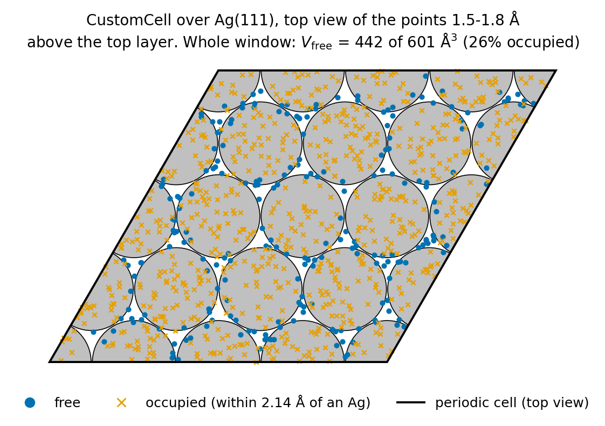
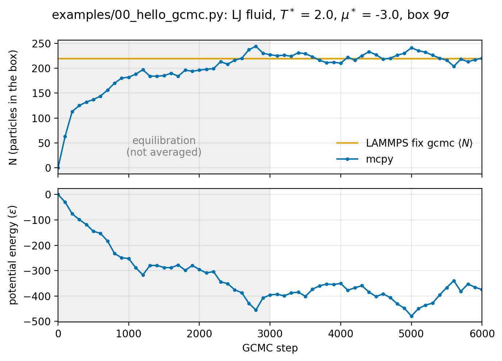
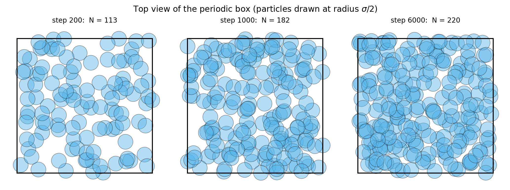
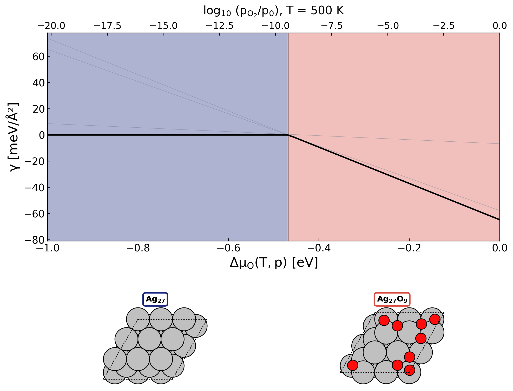

From a clean slab to an oxidation phase diagram
================================================

This tutorial builds a surface oxidation phase diagram.
Starting from a clean Ag(111) slab, you will run grand-canonical Monte Carlo
(GCMC) at a series of oxygen chemical potentials and turn the results into a
figure that shows which oxide coverages are stable under which conditions.
Every intermediate output is inspected along the way, so you can tell a
healthy run from a broken one before committing real compute.

GCMC samples the compositions the reservoir conditions favour.
You fix the temperature and the oxygen chemical potential, and the simulation
inserts and deletes oxygen atoms until the surface reaches the coverage those
conditions dictate.
That equilibrium coverage, swept across chemical potentials, is the phase
diagram.

.. contents::
   :local:
   :depth: 1

1. Installing mcpy and checking the setup
-----------------------------------------

mcpy installs from the repository.
The ``mcpy`` name on PyPI belongs to an unrelated macro library, so clone and
install from source (details in :doc:`installation`).

The ``mace`` extra installs the MLIP backend.
This tutorial evaluates energies with a MACE foundation model, and the extra
pulls in ``mace-torch``.
The CPU examples ``examples/00`` to ``examples/02`` need only the base install
(see :doc:`examples`).

An import check confirms the install.

.. code-block:: bash

   git clone https://github.com/farrisric/mcpy.git
   cd mcpy
   pip install -e .[mace]
   python -c "import mcpy; print('mcpy', mcpy.__version__)"

2. Building the slab and marking where oxygen can go
-----------------------------------------------------

Build the substrate
~~~~~~~~~~~~~~~~~~~

The starting configuration is a plain ASE ``Atoms`` object.
Anything you can build with ASE can seed a run, and here ``fcc111`` gives a
4x4x3 Ag slab with 8 Å of vacuum.

``FixAtoms`` anchors the bottom layer.
Trial moves are followed by a short relaxation, and without the constraint
the whole slab would drift with every accepted move instead of representing a
semi-infinite crystal.

Mark the insertion window
~~~~~~~~~~~~~~~~~~~~~~~~~

The ``CustomCell`` defines the insertion window.
It spans the full width of the box but only a 5 Å slice starting above the
top Ag layer, so every proposed oxygen lands near the surface instead of
somewhere in the vacuum.

``species_radii`` feeds the free-volume estimate.
The cell measures how much of its window is not already occupied by atoms,
counting a point as occupied when it falls within the given radius of an atom
of that element, and that free volume enters the GCMC acceptance rule
directly.
Insertions are drawn from the same free volume.

The radii come from a calibration.
The Ag radius, 2.14 Å, is the relaxed O-Ag bond of O in the fcc hollow of
Ag(111) with MACE-MPA-0, the potential of section 4.
:doc:`species_radii` shows how to measure the radius for your own potential: the most frequent O-Ag distance after relaxed insertions.
The O radius, 0.5 Å, only stops an insertion on top of an existing O atom.
A radius is the clearance that an incoming atom needs from an atom of that
species, so it depends on the incoming species too: an incoming Ag needs
2.75 Å from Ag (``examples/03_gcmc_surface_mace.py``).

One integer seeds the whole run.
The cell, each move, the move selector and the ensemble each own a random
stream, and all five seeds below derive from one ``SeedSequence``.
Leave any of them unset and the run cannot be repeated.

   The ``CustomCell`` built above, sampled by its own machinery
   (``docs/make_figures.py``), seen from above.
   The points are draws from ``cell.get_random_point()`` in a thin slice
   1.5-1.8 Å above the top Ag layer, classified with the cell's exclusion
   rule: points over an Ag atom are occupied, points over the hollows are
   free.
   The :math:`V_{\mathrm{free}}` in the title is what ``cell.get_volume()``
   reports for the whole window and the acceptance rule uses.

.. code-block:: python

   import numpy as np
   from ase.build import fcc111
   from ase.constraints import FixAtoms

   from mcpy.cell import CustomCell

   seed_cell, seed_ins, seed_del, seed_sel, seed_ens = (
       int(x) for x in np.random.SeedSequence(42).generate_state(5, dtype=np.uint32))

   # 4.165 A is the MACE-MPA-0 lattice constant of Ag
   atoms = fcc111('Ag', a=4.165, size=(4, 4, 3), vacuum=8.0, periodic=True)
   bottom = [a.index for a in atoms if a.tag == 3]
   atoms.set_constraint(FixAtoms(indices=bottom))

   cell = CustomCell(
       atoms,
       custom_height=5.0,
       bottom_z=atoms.positions[:, 2].max() + 0.5,
       species_radii={'Ag': 2.14, 'O': 0.5},
       mc_sample_points=100_000,
       seed=seed_cell,
   )

3. Choosing the trial moves
---------------------------

Composition changes need an insertion move and a deletion move.
``InsertionMove`` places a new O atom at a random point in the cell,
redrawing points that land inside an atom's exclusion sphere (the cell's
``species_radii``), and
``DeletionMove`` removes a random O atom from inside the cell.
Together they let the oxygen count fluctuate, which is the defining feature
of the grand-canonical ensemble.

``MoveSelector`` draws one move per trial.
The weights are relative frequencies, so ``[1, 1]`` attempts insertions and
deletions equally often, and the selector reports a separate acceptance ratio
for each move in the log.
One step runs ``round(sum(weights))`` trials by default, so here a step is two
trials.
The acceptance rule needs equal insertion and deletion probabilities for each
species.
If the weights make them differ, ``GrandCanonicalEnsemble`` raises
``ValueError``.

Each move and the selector take their seed from section 2.

.. code-block:: python

   from mcpy.moves import DeletionMove, InsertionMove, MoveSelector

   moves = MoveSelector(
       [1, 1],
       [InsertionMove(cell, species=['O'], seed=seed_ins),
        DeletionMove(cell, species=['O'], seed=seed_del)],
       seed=seed_sel,
   )

4. Wiring a calculator that relaxes each trial
----------------------------------------------

``MACE_F_Calculator`` relaxes each trial structure.
It wraps a MACE model in a short LBFGS geometry optimization, and the energy
handed to the acceptance rule is the relaxed one.
Here the model is the MACE-MPA-0 foundation model, which ``mace_mp``
downloads on first use.

Raw insertions land far from real bonding sites.
A random point in the free volume typically sits a fraction of an angstrom
off the nearest hollow site, and evaluated as placed it carries a repulsive
energy that would reject nearly every insertion.
Relaxing first lets acceptance reflect the chemistry of the nearby minimum
instead of the luck of the draw, which is what makes GCMC workable on a dense
metal surface (see :doc:`reference/calculators` for the calculator options).

``steps`` and ``fmax`` cap the relaxation budget.
Forty optimizer steps to a loose 0.1 eV/Å tolerance is enough to absorb the
placement noise, and a Monte Carlo run spends its budget better on more
trials than on converging each one to machine precision.

.. code-block:: python

   from mace.calculators import mace_mp

   from mcpy.calculators import MACE_F_Calculator

   calculator = MACE_F_Calculator(
       model_paths=mace_mp(model='medium-mpa-0', device='cuda',
                           default_dtype='float64'),
       steps=40,
       fmax=0.1,
   )

5. Running GCMC at one chemical potential
-----------------------------------------

Reference the chemical potential
~~~~~~~~~~~~~~~~~~~~~~~~~~~~~~~~

The oxygen chemical potential references the O\ :sub:`2` molecule.
The reservoir in an oxidation experiment is O\ :sub:`2` gas, so the natural
zero for one adsorbed O atom is half the energy of an O\ :sub:`2` molecule
computed with the same calculator.
``derive_mu_gas`` computes it with the running calculator, so the reference
stays correct when you change the potential.
A hardcoded number from another model silently shifts every
:math:`\Delta\mu`.
For a metal reservoir, ``derive_mu_bulk`` gives the bulk energy per atom at
the potential's own lattice constant
(``examples/04_replica_exchange_batched.py`` uses both).
For an electrochemical reservoir (water at a given pH and electrode
potential), ``mu_h_che`` and ``mu_o_che`` apply the computational hydrogen
electrode: :math:`\mu_\mathrm{H} = E(\mathrm{H_2})/2 - eU_\mathrm{SHE} - k_BT\ln 10\,\mathrm{pH}`
and :math:`\mu_\mathrm{O} = E(\mathrm{H_2O}) - 2\mu_\mathrm{H}`.
pH and potential only enter together as :math:`U_\mathrm{RHE}`, so at fixed
:math:`U_\mathrm{RHE}` the pH has no effect.
Both use bare energies, without zero-point or entropy corrections.

:math:`\Delta\mu` expresses the environmental conditions.
Values below zero correspond to oxygen-poor conditions such as high
temperature or low pressure, and values near zero to oxygen-rich ones.
Here a single condition at :math:`\Delta\mu = -0.3` eV serves as the test
run before the sweep.

Assemble and run
~~~~~~~~~~~~~~~~

``GrandCanonicalEnsemble`` ties every ingredient together.
In each step it runs the selector's trials: each trial draws a move,
evaluates the relaxed trial energy, applies the grand-canonical acceptance rule at the given ``mu`` and
``temperature``, and commits or rolls back the configuration.

The write intervals control the two output files.
The trajectory gets the current configuration every
``trajectory_write_interval`` steps, here every step, whether or not the
step was accepted.
The log gets one line every ``outfile_write_interval`` steps, here every ten
steps.
Expect the first step to be slower than the rest, since the model loads and
the cell samples its free volume once up front.

.. code-block:: python

   from mcpy.ensembles import GrandCanonicalEnsemble
   from mcpy.utils import derive_mu_gas

   mu_o_ref = derive_mu_gas(calculator, 'O2')   # E(O2)/2 with this calculator

   gcmc = GrandCanonicalEnsemble(
       atoms=atoms,
       cells=[cell],
       calculator=calculator,
       mu={'O': mu_o_ref - 0.3},     # Delta mu = -0.3 eV
       units_type='metal',
       species=['O'],
       temperature=500.0,
       move_selector=moves,
       random_seed=seed_ens,
       outfile='gcmc.out',
       traj_file='gcmc.xyz',
       outfile_write_interval=10,
       trajectory_write_interval=1,
   )
   gcmc.run(steps=1000)

Read the outputs
~~~~~~~~~~~~~~~~

The log tracks particle count, energy, and acceptance ratios.
Its header lists the run parameters, including the mcpy version (plus the
``git describe`` output when mcpy runs from a git checkout).
Each line carries the step index, the current atom count, the current
energy, and the acceptance ratio of every move since the previous line, in
the move order spelled out in the header.
The lines below show the layout; the numbers are illustrative.

.. code-block:: text

   Step       N_atoms    Energy (eV)     Acceptance Ratios (Ins, Del)
   -----------------------------------------------------------------
   0          48         -157.210000     N/A, N/A
   10         51         -160.830000     40.0%, 0.0%
   ...
   1000       58         -168.120000     25.5%, 12.0%

The trajectory opens directly in ASE.
Frames are extended XYZ with the energy and lattice on the comment line, so
``ase.io.read`` recovers everything the analysis below needs.

Convergence shows as a plateau in the oxygen count.
Plot the count against the frame index, and treat the run as equilibrated
only after the curve levels off and fluctuates around a steady value.

Unbalanced acceptance ratios signal an unconverged run.
While coverage is still climbing, insertions far outpace deletions, and in
the steady state the two ratios settle to comparable values.
A persistent imbalance after the count has flattened points at
mis-calibrated exclusion radii instead.

.. code-block:: python

   from ase.io import read

   traj = read('gcmc.xyz', index=':')
   n_oxygen = [sum(a.symbol == 'O' for a in frame) for frame in traj]
   # plot n_oxygen vs frame index: it should plateau in the second half

   What a healthy run looks like.
   The O/Ag run above needs a GPU, so the figure shows the same diagnostics
   for the CPU example ``examples/00_hello_gcmc.py``, a Lennard-Jones fluid,
   run exactly as shipped (``docs/make_figures.py``).
   The particle count climbs from the empty box, then fluctuates around the
   LAMMPS ``fix gcmc`` average for the same conditions (orange line, from
   ``benchmark/README.md``).
   The grey band is the equilibration that the example drops before it
   averages.

   Top views of the periodic box from the same run, at steps 200, 1000
   and 6000.

6. Sweeping the chemical potential
----------------------------------

One run samples one environmental condition.
The phase diagram needs the equilibrium answer at several chemical
potentials, and each one is an independent GCMC run that can execute in
sequence or in parallel.

A function parameterised on :math:`\Delta\mu` drives the sweep.
The body repeats sections 2 through 5 unchanged, so only the chemical
potential and the output paths vary between conditions.

Each condition writes into its own directory.
Condition-tagged paths keep the sweep restartable and make the collection
step below a one-liner.

The early frames belong to equilibration.
Every run starts from the same clean slab, so the first stretch of each
trajectory records the climb toward equilibrium rather than samples of it,
and the analysis will drop those frames.

.. code-block:: python

   from pathlib import Path

   def run_gcmc(delta_mu, steps=1000, seed=42):
       outdir = Path(f'sweep/dmu_{delta_mu:+.2f}')
       outdir.mkdir(parents=True, exist_ok=True)
       # rebuild atoms, cell, moves, and calculator exactly as in
       # sections 2-4, seeded per condition
       ...
       gcmc = GrandCanonicalEnsemble(
           ...,
           mu={'O': mu_o_ref + delta_mu},
           outfile=str(outdir / 'gcmc.out'),
           traj_file=str(outdir / 'gcmc.xyz'),
       )
       gcmc.run(steps=steps)

   for delta_mu in (-0.8, -0.6, -0.4, -0.2, 0.0):
       run_gcmc(delta_mu)

7. Assembling the phase diagram
-------------------------------

Collect the frames
~~~~~~~~~~~~~~~~~~

The sweep trajectories are the input.
:func:`mcpy.utils.plot_phase_diagram` accepts a list of
trajectories and flattens them, so passing one production slice per
condition is enough.

The clean slab serves as the reference.
Formation energies are measured against the lowest-energy oxygen-free frame
in the input, and since the production slices start after equilibration,
frame 0 of one run is kept to guarantee a clean reference exists.
Frame 0 is the starting configuration, the clean slab.

Draw the diagram
~~~~~~~~~~~~~~~~

``plot_phase_diagram`` computes one surface formation energy line per
oxygen count.
For each O count it keeps the lowest-energy frame.
The line of that frame gives the formation energy as a function of
:math:`\Delta\mu`, normalised by the surface area.

The lower envelope marks the stable phases.
At each :math:`\Delta\mu` the O count with the lowest formation energy wins,
and the winning stretches partition the axis into the stable coverages.
``results['phase_order']`` lists the winners from left to right as indices
into ``results['stoich']`` (the O counts), not into ``frames``.

The ``transitions`` array locates the phase boundaries.
Each entry is the :math:`\Delta\mu` where the envelope switches from one
structure to the next.
A twin axis converts the range into O\ :sub:`2` pressures at the given
temperature.
It reads :math:`p = p^0` at the standard chemical potential
:math:`\Delta\mu^0_{\mathrm{O}}(T)`, not at :math:`\Delta\mu = 0`.
At 500 K, :math:`\Delta\mu^0_{\mathrm{O}}` is -0.50 eV, so
:math:`\Delta\mu_{\mathrm{O}} = 0` is about 10 decades above :math:`p^0`.
For O and H the function takes :math:`\Delta\mu^0(T)` from built-in
NIST-JANAF tables; for other gases, give it with ``dmu_standard``.

Thumbnails show one structure per stable phase.
The figure renders the winning configuration of each stretch above the
envelope, so the diagram reads as structures, not curve indices.
:doc:`phase_diagrams` covers every knob, including nanoparticle
normalisation and molecular adsorbates.

.. code-block:: python

   from ase.io import read

   from mcpy.utils import plot_phase_diagram

   # The lowest-energy O-free frame is the reference, so keep frame 0
   # (the clean slab) even though the equilibration frames are dropped.
   clean = read('sweep/dmu_-0.80/gcmc.xyz', index='0')

   frames = [clean] + [
       read(f'sweep/dmu_{dmu:+.2f}/gcmc.xyz', index='500:')   # drop equilibration
       for dmu in (-0.8, -0.6, -0.4, -0.2, 0.0)
   ]

   results = plot_phase_diagram(
       frames,
       adsorbate='O',
       metal_symbols=('Ag',),
       mu_ref=mu_o_ref,
       kind='surface',
       T=500.0,
       dmu_range=(-1.0, 0.0),
       outfile='phase_diagram.png',
   )
   print(results['transitions'])   # Delta mu values of the phase boundaries

   The diagram that this call produces on the EMT edition of the sweep
   (``docs/make_figures.py``, which runs the code above verbatim).
   The sweep itself differs from sections 2 to 6 in three ways: EMT
   replaces MACE, the slab is 3x3x3, and the O insertion is capped at one O
   per surface Ag (``max_atoms=9``).
   EMT has no real O-Ag chemistry, and without the cap its O coverage grows
   without limit.
   The figure therefore shows how to read the diagram, not the physics of O
   on Ag.
   Grey lines are the other O counts (the lowest-energy frame of each),
   the thick line is the stable envelope,
   and the shading marks the stable phases, numbered like their structure
   thumbnails: the clean slab below
   :math:`\Delta\mu_{\mathrm{O}} \approx -0.47` eV, the capped
   monolayer above -0.455 eV, and between them a narrow O\ :sub:`8` phase.
   The top axis converts :math:`\Delta\mu_{\mathrm{O}}` into O\ :sub:`2`
   pressure at 500 K, with :math:`p = p^0` at
   :math:`\Delta\mu_{\mathrm{O}} = -0.50` eV.
   For a MACE diagram see :doc:`phase_diagrams`.

8. Where to go next
-------------------

Production runs need calibrated exclusion radii.
:doc:`species_radii` derives them from relaxed insertion trials with your
own potential.

Molecular adsorbates exchange whole molecules with the reservoir.
:doc:`molecular_adsorbates` covers rigid insertion, deletion, and
displacement of species such as CO and O\ :sub:`2`.

Replica exchange runs every condition in parallel.
:doc:`ensembles` describes the MPI and single-GPU batched variants, either
of which can replace the sequential loop of section 6.

Other cells fit nanoparticles and supported particles.
:doc:`cells` maps each geometry to its cell type, from periodic boxes to
spheres and domes.

The notebooks repeat these workflows with executed output.
The :doc:`notebooks page <notebooks>` lists them, from GCMC basics to the
CO/CuPd replica-exchange study, with every cell already run.
