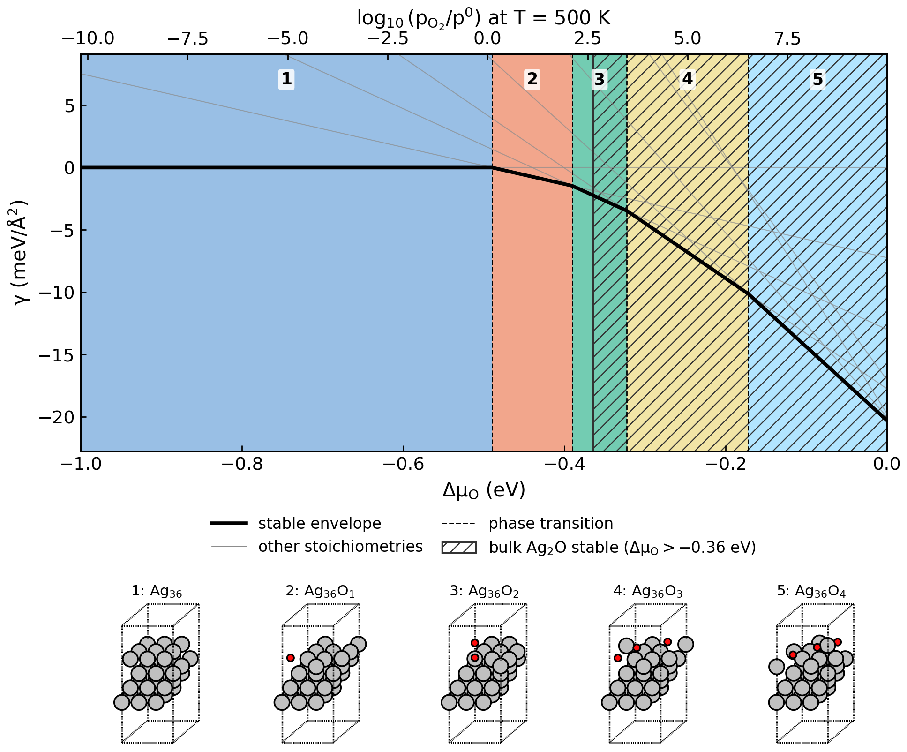

Building phase diagrams from GCMC output
========================================

:func:`mcpy.utils.plot_phase_diagram` turns the trajectories of a
chemical-potential sweep into a phase diagram: it computes the formation energy
of every frame, takes the exact lower envelope of the free-energy lines, and
renders the figure with a numbered structure thumbnail per stable phase.

Build the diagram from a sweep
------------------------------

Collect one production slice per condition, keep one adsorbate-free frame as
the clean reference (the function raises an error without one), and call the
function:

.. code-block:: python

   from ase.io import read

   from mcpy.utils import plot_phase_diagram

   # keep frame 0 (the clean starting slab) as the reference
   clean = read('sweep/dmu_-0.80/gcmc.xyz', index='0')

   frames = [clean] + [
       read(f'sweep/dmu_{dmu:+.2f}/gcmc.xyz', index='500:')   # drop equilibration
       for dmu in (-0.8, -0.6, -0.4, -0.2, 0.0)
   ]

   results = plot_phase_diagram(
       frames,
       adsorbate='O',
       metal_symbols=('Ag',),
       mu_ref=mu_o_ref,          # E(O2)/2 on your calculator's scale (derive_mu_gas)
       kind='surface',           # or 'nano' for nanoparticles
       T=500.0,
       dmu_range=(-1.0, 0.0),
       outfile='phase_diagram.png',
   )
   print(results['transitions'])   # Delta mu values of the phase boundaries

``frames`` takes a flat list of ``Atoms`` or a list of trajectories and
flattens them; frames written by mcpy carry their energy on the comment line,
so nothing is re-evaluated.
If the runs also exchange metal atoms, pass ``mu_metal`` (see below).
Without it, the function raises an error when the frames hold different
metal counts.
The returned dict carries the grid (``dmu_grid``), the per-frame lines
(``free``), the envelope (``min_gamma``), the winning frame indices
(``stable_idx``, ``phase_order``), and the boundary positions
(``transitions``).

   A surface diagram: O on a 3x3 Ag(111) slab at 500 K, MACE-MH-1
   (``phase_diagram`` notebook).
   The y axis is the surface free energy :math:`\gamma` in meV/Ų.
   Grey lines are the lowest-energy frames of the other O counts, the thick
   black line is the stable envelope, and the numbered regions are the
   stable phases (0 to 4 O atoms, shown in the thumbnails).
   Only rungs with :math:`\Delta\mu_{\mathrm{O}} \le -0.30` eV, which
   reached a coverage plateau, enter the diagram.
   Above that the slab keeps oxidising, so those frames are not
   equilibrium surface phases.
   Above -0.30 eV the envelope extrapolates the lines of those frames.
   The hatched range (``hatch_from``) marks
   :math:`\Delta\mu_{\mathrm{O}} > -0.365` eV, where bulk
   Ag\ :sub:`2`\ O is more stable than any surface phase.
   The top axis converts :math:`\Delta\mu_{\mathrm{O}}` into O\ :sub:`2`
   pressure.
   It reads :math:`p = p^0` at
   :math:`\Delta\mu_{\mathrm{O}} = \Delta\mu^0_{\mathrm{O}}(T)`, which is
   -0.50 eV at 500 K.
   The notebook writes this figure with one ``plot_phase_diagram`` call.

Key parameters
--------------

``kind``
   ``'surface'`` normalizes by the in-plane cell area (meV/Ų);
   ``'nano'`` normalizes by the metal-atom count (meV/atom), which keeps
   particles of different sizes comparable.
   ``gamma_in_ev=True`` skips the normalisation.

``mu_ref``
   The adsorbate reference on your calculator's energy scale, for example
   half the O\ :sub:`2` energy.
   The twin pressure axis converts :math:`\Delta\mu` at the given ``T``
   (see ``dmu_standard``).

``mu_metal``
   The chemical potentials of the metal species, as a dict, for example
   ``{'Ag': mu_ag}``.
   Use the values of the GCMC runs.
   Pass it when the runs exchange metal atoms, for example O and Ag on
   Ag(111) (``examples/03_gcmc_surface_mace.py`` with ``EXCHANGE_AG = True``).
   Each frame then scores
   :math:`E - \sum_m \mu_m (N_m - N_{m,\mathrm{ref}})`.
   The clean frame with the lowest score is the reference.
   For each adsorbate count, the frame with the lowest score is the phase.
   ``results['phase_metal_counts']`` gives the metal counts of each phase.
   The function raises an error if the frames hold different counts of a
   metal species and ``mu_metal`` does not give it.

``dmu_standard``
   The standard chemical potential
   :math:`\Delta\mu^0(T)` of the adsorbate at :math:`p^0`, in eV per adsorbed
   unit.
   The twin axis shows
   :math:`\log_{10}(p/p^0) = n\,(\Delta\mu - \Delta\mu^0(T)) / (k_B T \ln 10)`,
   with :math:`n` = ``atoms_per_reservoir_molecule``.
   For O from O\ :sub:`2` and H from H\ :sub:`2`, the default ``None`` takes
   :math:`\Delta\mu^0(T)` from built-in NIST-JANAF tables (100 to 1000 K).
   These tables use the convention of Reuter and Scheffler (PRB 65, 035406,
   2001): the reference is the total energy of the molecule, without
   zero-point energy.
   For O, they agree with Table I of that paper within 0.006 eV.
   The axis is exact only if ``mu_ref`` includes :math:`\mathrm{ZPE}/n`,
   with ZPE the zero-point energy of the molecule.
   With a bare ``mu_ref``, for example from ``derive_mu_gas``, the true
   :math:`p = p^0` is at :math:`\Delta\mu^0(T) + \mathrm{ZPE}/n`.
   This shift is 0.049 eV for O (1.0 decade at 500 K) and 0.135 eV for H
   (4.5 decades at 300 K).
   To show the true gas pressure with a bare ``mu_ref``, pass
   ``dmu_standard`` = :math:`\Delta\mu^0(T) + \mathrm{ZPE}/n`.
   For any other adsorbate, for example CO, give the value yourself.
   Also give it for a ``T`` outside 100 to 1000 K.
   If you do not, the function omits the pressure axis and logs a warning.
   The phases and transitions do not change.

``n_bins`` / ``min_phase_width``
   Resolution of the returned :math:`\Delta\mu` grid (``dmu_grid``,
   ``free``, ``min_gamma``), and the width below which a phase gets its
   number on a second row of the plot.
   Neither changes the phases: every phase on the envelope is kept, and the
   transitions are the exact crossings of the free-energy lines, so the
   dashed lines sit on the kinks of the envelope.

``hatch_from`` / ``hatch_label``
   Hatch the range :math:`\Delta\mu >` ``hatch_from``, with a legend
   entry, for example where the bulk oxide is more stable than any surface
   phase.

``dpi``
   Resolution of the saved figure (default 250).
   Neighbouring phases always get different colours from a colourblind-safe
   palette, and the number on each region is also on its thumbnail.

``adsorbate_count_fn`` / ``adsorbate_label``
   A custom ``atoms -> int`` counter for adsorbates whose element also sits
   in an inert sublattice (for example O adsorbed on a particle supported by
   an oxide), and the species name used in axis labels when the counted
   symbol is a proxy.

``atoms_per_reservoir_molecule``
   Reservoir stoichiometry :math:`n` for the pressure axis.
   The default ``2`` is the dissociative-diatomic convention (atomic O from
   an O\ :sub:`2` reservoir); pass ``1`` for molecular adsorbates such as CO,
   whose thumbnails then read as (CO)\ :sub:`n`.

.. figure:: _static/fig_phase_diagram_co_cupd.png
   :alt: Phase diagram of CO on a CuPd nanoparticle with structure thumbnails.
   :width: 100%
   :align: center

   A molecular nanoparticle diagram: CO on Cu\ :sub:`33`\ Pd\ :sub:`5` at
   400 K, ``kind='nano'`` (:math:`\Delta G` in meV per metal atom) and
   ``atoms_per_reservoir_molecule=1``.
   The numbered regions are the stable (CO)\ :sub:`n` phases,
   n = 0, 1, 2, 3, 5 and 6; phases 2 and 4 are narrow (0.009 and 0.02 eV),
   so their numbers sit on a second row.
   The run is not converged above -1.45 eV (phase 6).

``analyze_phase_diagram_results(trajectory_path, host_symbol, oxygen_symbol, idx_ref, ...)``
   The older oxidation-specific entry point: reads one concatenated
   trajectory from disk and works against tabulated host and oxide reference
   energies.
   Prefer ``plot_phase_diagram`` for new work.

Worked examples
---------------

- Section 7 of :doc:`getting_started` builds the O/Ag(111) diagram from the
  tutorial sweep.
- The phase-diagram notebook builds a diagram interactively with executed
  output (see :doc:`notebooks`).
- The CO/CuPd replica-exchange notebook ends in the molecular nanoparticle
  diagram above.
