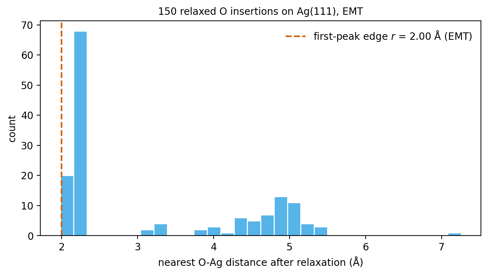

Calibrating `species_radii`
===========================

`species_radii` is the element-wise dictionary that controls how the free-volume Monte Carlo
estimator decides whether a sampled point is occupied. Because :math:`V_{\mathrm{free}}` enters
the GCMC insertion and deletion acceptance terms directly (see :ref:`free-volume`), the
quality of these radii is a sensitive input -- not a tuning knob to leave at default values.

The exclusion radius for a host species is :math:`r_{\mathrm{relax}}` (the name in the thesis behind this library).
:math:`r_{\mathrm{relax}}` is the **most frequent nearest adsorbate-host distance after a local relaxation** with the calculator used in production.
It is the centre of the tallest bin in the histogram of these distances.
The tallest bin is normally in the binding peak, which holds the trials that bind to the host.
Every value of `species_radii` is tied to the specific calculator and relaxation settings used during production; re-calibrate if either changes.

Free-volume estimate (recap)
----------------------------

For completeness, the estimator used by every cell object in `mcpy` is:

.. math::

   I_k =
   \begin{cases}
   1, & \exists\, a\ \text{such that}\ \|\mathbf{x}_k-\mathbf{r}_a\|^2 \le r_{\mathrm{species}(a)}^2,\\
   0, & \text{otherwise,}
   \end{cases}
   \qquad
   V_{\mathrm{free}} = V_{\mathrm{cell}}\,\bigl(1 - \tfrac{1}{N_{\mathrm{MC}}}\textstyle\sum_k I_k\bigr).

See :ref:`free-volume` for the role of :math:`V_{\mathrm{free}}` in the GCMC acceptance terms.

.. figure:: _static/fig_free_volume.png
   :alt: Sample points in a slab window classified as free or occupied.
   :width: 85%
   :align: center

   The estimator at work in a ``CustomCell`` over an Ag(111) slab, sampled
   by the cell itself (``docs/make_figures.py``). Each point drawn by
   ``cell.get_random_point()`` is classified against the exclusion disks of
   radius :math:`r_{\mathrm{Ag}}` (dotted circles); the free fraction sets
   the :math:`V_{\mathrm{free}}` that ``cell.get_volume()`` returns.

Measure the radius from relaxed insertions
------------------------------------------

Put a trial adsorbate at a random position above the surface.
Relax each trial with your production calculator.
Record the nearest adsorbate-host distance after the relaxation.
The centre of the tallest histogram bin is :math:`r_{\mathrm{relax}}`:

.. code-block:: python

   import numpy as np
   from ase.build import fcc111
   from ase.constraints import FixAtoms
   from ase.optimize import LBFGS

   rng = np.random.default_rng(11)
   slab0 = fcc111('Ag', a=4.085, size=(3, 3, 3), vacuum=8.0, periodic=True)
   z_top = slab0.positions[:, 2].max()

   distances = []
   for _ in range(150):
       slab = slab0.copy()
       slab.set_constraint(FixAtoms(indices=[a.index for a in slab if a.tag == 3]))
       slab.append('O')
       slab.positions[-1] = [rng.uniform(0, slab.cell[0, 0]),
                             rng.uniform(0, slab.cell[1, 1]),
                             z_top + rng.uniform(1.0, 3.5)]
       slab.calc = calculator          # your production calculator
       LBFGS(slab, logfile=None).run(fmax=0.1, steps=50)
       d = slab.get_distances(len(slab) - 1, range(len(slab) - 1), mic=True)
       distances.append(d.min())

   bin_width = 0.05                        # Å
   counts, edges = np.histogram(distances,
                                bins=np.arange(0.0, max(distances) + bin_width, bin_width))
   r_relax = edges[np.argmax(counts)] + bin_width / 2   # centre of the tallest bin

   The histogram this loop produces (O on Ag(111); EMT stands in for the
   production calculator, generated by ``docs/make_figures.py``).
   The binding peak, from 1.95 to 2.3 Å, collects the chemisorbed outcomes.
   Its tallest bin is :math:`r_{\mathrm{relax}}`.
   EMT gives about 2.17 Å.
   The small cluster near 2.0 Å in this peak is O on top of one Ag atom.

The tutorial and ``examples/03`` use 2.14 Å.
That value is not a histogram mode.
It is the O-Ag bond of one O atom relaxed in the fcc hollow of Ag(111) with MACE-MPA-0.

The bin width is 0.05 Å.
The bin centre then gives :math:`r_{\mathrm{relax}}` to within 0.025 Å.
For this slab and the cell of the next section, a 0.025 Å change of the Ag radius changes :math:`V_{\mathrm{free}}` by less than 1 %.
Wider bins blur the peak.
Narrower bins hold too few trials, so one trial more or less can move the tallest bin.

Do not use a percentile or the lower edge of the peak.
A few unusual trials can move them far from the peak.
In the figure, the 5th percentile is 2.00 Å, in the on-top cluster.
If more than 5 % of the trials form a bump at a short distance, for example near 1 Å, the 5th percentile falls into the bump.
Near 5 %, a small change of the bump moves the percentile between the peak, the gap and the bump.
The same bump does not change the tallest bin.

The far cluster of large distances comes from trials that did not bind during the relaxation.
It is spread over many bins, so it does not hold the tallest bin when most trials bind.
If it does hold the tallest bin, start the trials nearer to the surface or relax them for more steps.
``scripts/compute_radii.py`` packages this loop for FCC(111) hosts with a MACE model.
It uses the same rule, the tallest bin.
But it divides the distance range into 100 bins, so its bin width depends on the data.
For distances from 0.3 to 8 Å, a bin is about 0.08 Å wide, and the result is good to about 0.04 Å.

Use the value in a simulation
-----------------------------

A radius belongs to the atom that is already present.
An insertion point is excluded when it lies within ``species_radii[symbol]`` of an atom of
that symbol, whatever species is being inserted.
Put the measured O-host distance on the host species.
The radius on O itself sets how close a new atom may land to an existing O; a small
clearance such as 0.5 Å only stops insertions on top of an O atom.
If two species are inserted and need different clearances, give each its own cell over the
same region (``examples/03_gcmc_surface_mace.py`` does this for O and Ag).

.. code-block:: python

   cell = CustomCell(
       atoms,
       custom_height=5.0,
       bottom_z=atoms.positions[:, 2].max() + 0.5,
       species_radii={'Ag': r_relax, 'O': 0.5},
   )

Validate with a short pilot run before production: the insertion acceptance ratio and the
reported :math:`V_{\mathrm{free}}` should both be stable and non-degenerate.
